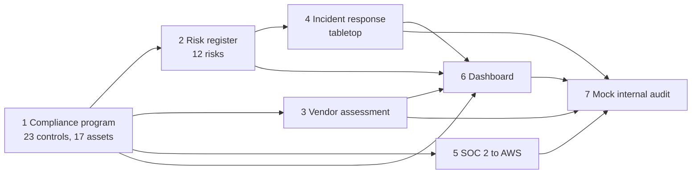

<p align="center">


</p>

# 7 Hands-On GRC Projects

   

Seven connected GRC deliverables for one fictional company, **NovaCloud AI Solutions**, a 10-person cloud startup preparing for ISO/IEC 27001 certification. Each project is a finished work product, and together they form one compliance program: a control baseline, a risk register, a vendor review, an incident response plan, a SOC 2 to AWS mapping, a dashboard and an internal audit.

The seven project themes follow the public guide *7 Hands-On Projects for Skills and Resume* by Artem Polynko. All the work in this repository is original.

## The projects

| # | Project | What it delivers | Headline result |
|---|---|---|---|
| 1 | [**Mini compliance program**](projects/01-mini-compliance-program/README.md) | ISO 27001 scope, asset inventory and control matrix | 23 Annex A controls assessed: 7 implemented, 12 partial, 4 planned |
| 2 | [**Risk register**](projects/02-risk-register/README.md) | 12 scored risks with inherent, current and target residual risk and heat maps | High risks 3 → 0 with current controls |
| 3 | [**Vendor risk assessment**](projects/03-vendor-risk-assessment/README.md) | 25-question questionnaire, criticality scorecard and a completed Notion assessment | Notion 80% (Acceptable); 12 vendors ranked |
| 4 | [**Incident response plan**](projects/04-incident-response-plan/README.md) | ISO 27035-aligned plan, phishing tabletop and incident report | 5 gaps found, each with an owned action |
| 5 | [**SOC 2 to AWS mapping**](projects/05-soc2-aws-control-mapping/README.md) | 14 criteria mapped to AWS services, with CLI checks and an evidence guide | 26 evidence items planned |
| 6 | [**Compliance dashboard**](projects/06-compliance-dashboard/README.md) | Formula-driven Excel dashboard and image tracking controls, risks and actions | 152 formulas, 4 charts, 24 actions |
| 7 | [**Mock internal audit**](projects/07-mock-internal-audit/README.md) | 10-control audit with checklist, report and corrective action plan | 10 findings: 1 major, 5 minor, 4 observations |

## How they connect

The projects share one dataset, so numbers and IDs agree across every document, and the final audit checks them against each other.



## The company in brief

NovaCloud AI Solutions sells an AI document analysis service on AWS to businesses in the US and EU, with 10 staff working remotely. See the [company profile](docs/company-profile.md) for roles, assets and the project timeline.

## Headline numbers

| Area | Result |
|---|---|
| Controls | 23 assessed: 7 implemented (30%), 12 partial, 4 planned; average maturity 2.1 of 5 |
| Risks | 12 registered; High risks 3 inherent, 0 current; target 6 Low and 6 Medium |
| Vendors | 12 ranked by criticality; 1 assessed (Notion 80%, approved with conditions) |
| Incident response | 1 tabletop, 5 gaps, 5 actions |
| Remediation | 24 actions: 6 done, 10 in progress, 8 not started |
| Internal audit | 10 findings (1 major, 5 minor, 4 observations); not yet ready for a Stage 1 audit |

## What makes this more than a basic lab

- **One story, one dataset.** Every document draws on the same assets, controls, risks and actions, so IDs resolve and counts reconcile.
- **Honest status.** Controls are Implemented, Partial or Planned. Risks show current and target residual. The SOC 2 evidence is a plan, not a claim.
- **Evidence-based vendor review.** Each answer cites a published source, and what could not be confirmed is stated.
- **A tabletop that finds real gaps,** and turns each into an owned, dated action.
- **A working dashboard.** Formulas and charts, not typed numbers.
- **An audit that tests the portfolio against itself,** and feeds new actions back in.

## Resume lines

1. Built an ISO 27001:2022 control matrix for a 10-person cloud startup, assessing 23 Annex A controls (7 implemented, 12 partial, 4 planned), scoring maturity and assigning owners and actions.
2. Built a 12-risk register with a 5×5 scoring model and inherent, current and target residual ratings, showing High risks falling from 3 to 0 with existing controls.
3. Designed a 25-question vendor security questionnaire and criticality matrix; assessed Notion from public documentation (80%, approved with conditions) and ranked 12 vendors.
4. Wrote an ISO 27035-aligned incident response plan and ran a phishing tabletop that exposed 5 gaps, each converted into a corrective action.
5. Mapped 14 SOC 2 criteria to AWS services with verification commands and a 26-item evidence plan.
6. Built a formula-driven Excel compliance dashboard (152 formulas, 4 charts) tracking 23 controls, 12 risks and 24 actions.
7. Conducted a mock ISO 27001 internal audit of the full program, raising 10 findings and a corrective action plan.

## Repository structure

```
grc-analyst-portfolio-projects/
├── README.md
├── REPO_DESCRIPTION.txt
├── assets/
│   ├── banner.jpg
│   └── social-banner.jpg
├── docs/company-profile.md
└── projects/
    ├── 01-mini-compliance-program/
    ├── 02-risk-register/
    ├── 03-vendor-risk-assessment/
    ├── 04-incident-response-plan/
    ├── 05-soc2-aws-control-mapping/
    ├── 06-compliance-dashboard/
    └── 07-mock-internal-audit/
```

## Notes on use

- The company, people, incidents and figures are fictional.
- The Notion assessment uses Notion's published pages as read in November 2026. It is a method exercise, not a statement about Notion's current controls.
- The SOC 2 evidence screenshots are not included because they must come from a real sandbox account. The [evidence guide](projects/05-soc2-aws-control-mapping/evidence-guide.md) shows how to capture them.
- Framework references are paraphrased pointers. Verify them against the source text.

## Disclaimer

NovaCloud AI Solutions is a fictional company. All people, systems, incidents, ratings and dates are examples created for skills practice and portfolio use. This is not legal advice or a compliance determination. Framework references are paraphrased pointers, so verify them against the source text before relying on them.

## Author

Augustine Ozor, AI Governance and Cybersecurity GRC. [GitHub](https://github.com/AugustineOzor) · [LinkedIn](https://www.linkedin.com/in/augustinetettehozor)
