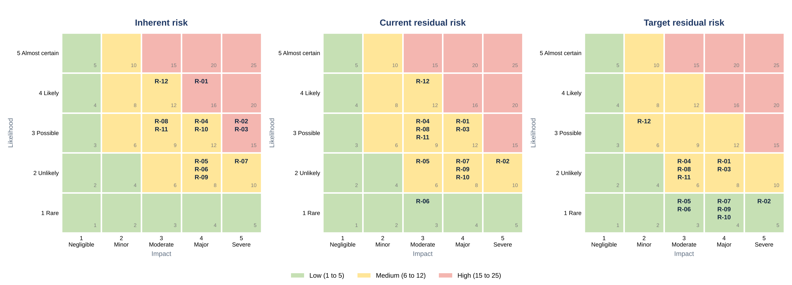

# Risk register

[← Project 2 README](README.md)

12 risks for NovaCloud AI Solutions. Each risk is scored by **likelihood × impact** on a 5 × 5 scale, then re-scored after the controls that exist today (**current residual**) and after planned mitigations (**target residual**).

## Scoring method

| Score | Likelihood | Impact |
|---|---|---|
| 1 | Rare: not expected in the next year | Negligible: no customer or business effect |
| 2 | Unlikely: could happen but not expected | Minor: small internal disruption |
| 3 | Possible: could well happen in the next year | Moderate: some customer data or service affected |
| 4 | Likely: expected within the year | Major: significant customer data exposure or outage |
| 5 | Almost certain: expected in months | Severe: large breach, loss of customers or certification |

| Rating | Score | Colour |
|---|---|---|
| Low | 1 to 5 | 🟩 Green |
| Medium | 6 to 12 | 🟨 Yellow |
| High | 15 to 25 | 🟥 Red |

## Inherent risk and mitigation

| ID | Risk | Likelihood | Impact | Score | Rating | Mitigation | Owner |
|---|---|---|---|---|---|---|---|
| R-01 | **Phishing leads to account takeover.** Attackers phish a staff member and take over their Google or AWS account, then read customer data or send further phishing. | 4 Likely | 4 Major | 16 | 🟥 High | MFA on all accounts (done); awareness training and phishing simulation; email filtering; move to phishing-resistant MFA. | CTO |
| R-02 | **Misconfigured S3 bucket exposes customer documents.** A bucket or object is made public by mistake, exposing customer documents that may contain personal data. | 3 Possible | 5 Severe | 15 | 🟥 High | Account-wide S3 Block Public Access; AWS Config rules for public buckets; infrastructure changes reviewed before deploy. | CTO |
| R-03 | **Leaked credentials or access keys in code.** A developer commits an access key or password to GitHub, giving an attacker access to AWS or a database. | 3 Possible | 5 Severe | 15 | 🟥 High | Secret scanning and push protection on GitHub; roles instead of long-lived keys; rotate secrets; 1Password for shared secrets. | Engineering Lead |
| R-04 | **Unpatched dependency exploited.** A known vulnerability in an application library or container image is exploited before it is fixed. | 3 Possible | 4 Major | 12 | 🟨 Medium | Dependency scanning on every pull request; weekly infrastructure scans; fix times by severity. | Engineering Lead |
| R-05 | **Ransomware on a staff laptop.** Malware encrypts a laptop and synced files, interrupting work and risking data loss. | 2 Unlikely | 4 Major | 8 | 🟨 Medium | EDR and MDM on all laptops; backups of shared drives; staff reporting channel. | Operations Manager |
| R-06 | **Lost or stolen laptop.** A laptop holding cached customer data is lost or stolen. | 2 Unlikely | 4 Major | 8 | 🟨 Medium | Enforced disk encryption; remote wipe through MDM; screen lock. | Operations Manager |
| R-07 | **Database failure or deletion without a tested restore.** The production database is corrupted or deleted and the backup cannot be restored in time. | 2 Unlikely | 5 Severe | 10 | 🟨 Medium | Automated backups; deletion protection; quarterly restore test; defined RTO and RPO. | CTO |
| R-08 | **Breach at a SaaS vendor.** A vendor such as Notion, Slack or HubSpot is breached, exposing internal or customer data held there. | 3 Possible | 3 Moderate | 9 | 🟨 Medium | Vendor assessment by tier; DPAs; rule that secrets and customer files are not stored in collaboration tools. | Operations Manager |
| R-09 | **Excessive standing admin access.** Standing administrator rights are misused or taken over, allowing wide damage. | 2 Unlikely | 4 Major | 8 | 🟨 Medium | Least privilege; time-limited admin roles; quarterly access review; CloudTrail alerts. | CTO |
| R-10 | **Customer data leaks through the AI features.** Prompt injection or a tenant isolation fault exposes one customer's documents to another, or to a model provider. | 3 Possible | 4 Major | 12 | 🟨 Medium | Tenant isolation tests; no training on customer data without consent; input and output filtering; annual penetration test; model provider reviewed. | Engineering Lead |
| R-11 | **Privacy law non-compliance.** NovaCloud cannot meet data subject requests or contract duties because it has no record of processing or DPA template. | 3 Possible | 3 Moderate | 9 | 🟨 Medium | Record of processing; DPA template; data subject request procedure. | CEO |
| R-12 | **Dependence on a few key people.** One engineer holds production knowledge and credentials, so absence or departure stalls operations. | 4 Likely | 3 Moderate | 12 | 🟨 Medium | Runbooks; shared on-call; documented break-glass access; cross-training. | CEO |

## Residual risk and review

Current residual reflects controls already operating. Target residual assumes the planned mitigations are finished. The controls column links each risk to the [ISO 27001 control matrix](../01-mini-compliance-program/03-iso-27001-control-matrix.md).

| ID | Risk | Current residual (L × I) | Current rating | Target residual (L × I) | Target rating | Controls | Review date |
|---|---|---|---|---|---|---|---|
| R-01 | Phishing leads to account takeover | 3 × 4 = 12 | 🟨 Medium | 2 × 4 = 8 | 🟨 Medium | A.8.5, A.6.3 | 28 Feb 2027 |
| R-02 | Misconfigured S3 bucket exposes customer documents | 2 × 5 = 10 | 🟨 Medium | 1 × 5 = 5 | 🟩 Low | A.5.23, A.8.32 | 28 Feb 2027 |
| R-03 | Leaked credentials or access keys in code | 3 × 4 = 12 | 🟨 Medium | 2 × 4 = 8 | 🟨 Medium | A.8.2, A.8.24 | 28 Feb 2027 |
| R-04 | Unpatched dependency exploited | 3 × 3 = 9 | 🟨 Medium | 2 × 3 = 6 | 🟨 Medium | A.8.8 | 31 May 2027 |
| R-05 | Ransomware on a staff laptop | 2 × 3 = 6 | 🟨 Medium | 1 × 3 = 3 | 🟩 Low | A.8.7, A.8.1 | 31 May 2027 |
| R-06 | Lost or stolen laptop | 1 × 3 = 3 | 🟩 Low | 1 × 3 = 3 | 🟩 Low | A.8.1, A.7.7 | 31 May 2027 |
| R-07 | Database failure or deletion without a tested restore | 2 × 4 = 8 | 🟨 Medium | 1 × 4 = 4 | 🟩 Low | A.8.13, A.5.30 | 28 Feb 2027 |
| R-08 | Breach at a SaaS vendor | 3 × 3 = 9 | 🟨 Medium | 2 × 3 = 6 | 🟨 Medium | A.5.19 | 31 May 2027 |
| R-09 | Excessive standing admin access | 2 × 4 = 8 | 🟨 Medium | 1 × 4 = 4 | 🟩 Low | A.8.2, A.5.15 | 31 May 2027 |
| R-10 | Customer data leaks through the AI features | 2 × 4 = 8 | 🟨 Medium | 1 × 4 = 4 | 🟩 Low | A.5.19, A.8.8 | 31 May 2027 |
| R-11 | Privacy law non-compliance | 3 × 3 = 9 | 🟨 Medium | 2 × 3 = 6 | 🟨 Medium | A.5.34 | 31 May 2027 |
| R-12 | Dependence on a few key people | 4 × 3 = 12 | 🟨 Medium | 3 × 2 = 6 | 🟨 Medium | A.5.2 | 31 May 2027 |

## Heat maps

### Inherent risk

| Likelihood ↓ / Impact → | 1 | 2 | 3 | 4 | 5 |
|---|---|---|---|---|---|
| **5 Almost certain** | 🟩 | 🟨 | 🟥 | 🟥 | 🟥 |
| **4 Likely** | 🟩 | 🟨 | 🟨 R-12 | 🟥 R-01 | 🟥 |
| **3 Possible** | 🟩 | 🟨 | 🟨 R-08, R-11 | 🟨 R-04, R-10 | 🟥 R-02, R-03 |
| **2 Unlikely** | 🟩 | 🟩 | 🟨 | 🟨 R-05, R-06, R-09 | 🟨 R-07 |
| **1 Rare** | 🟩 | 🟩 | 🟩 | 🟩 | 🟩 |

### Current residual risk

| Likelihood ↓ / Impact → | 1 | 2 | 3 | 4 | 5 |
|---|---|---|---|---|---|
| **5 Almost certain** | 🟩 | 🟨 | 🟥 | 🟥 | 🟥 |
| **4 Likely** | 🟩 | 🟨 | 🟨 R-12 | 🟥 | 🟥 |
| **3 Possible** | 🟩 | 🟨 | 🟨 R-04, R-08, R-11 | 🟨 R-01, R-03 | 🟥 |
| **2 Unlikely** | 🟩 | 🟩 | 🟨 R-05 | 🟨 R-07, R-09, R-10 | 🟨 R-02 |
| **1 Rare** | 🟩 | 🟩 | 🟩 R-06 | 🟩 | 🟩 |

### Target residual risk

| Likelihood ↓ / Impact → | 1 | 2 | 3 | 4 | 5 |
|---|---|---|---|---|---|
| **5 Almost certain** | 🟩 | 🟨 | 🟥 | 🟥 | 🟥 |
| **4 Likely** | 🟩 | 🟨 | 🟨 | 🟥 | 🟥 |
| **3 Possible** | 🟩 | 🟨 R-12 | 🟨 | 🟨 | 🟥 |
| **2 Unlikely** | 🟩 | 🟩 | 🟨 R-04, R-08, R-11 | 🟨 R-01, R-03 | 🟨 |
| **1 Rare** | 🟩 | 🟩 | 🟩 R-05, R-06 | 🟩 R-07, R-09, R-10 | 🟩 R-02 |

## Summary

| Rating | Inherent | Current residual | Target residual |
|---|---|---|---|
| 🟥 High | 3 | 0 | 0 |
| 🟨 Medium | 9 | 11 | 6 |
| 🟩 Low | 0 | 1 | 6 |

Review dates: risks that started High are reviewed quarterly (28 February 2027); the others every six months (31 May 2027).

---

*NovaCloud AI Solutions is a fictional company. All people, systems, incidents, ratings and dates are examples created for skills practice and portfolio use. This is not legal advice or a compliance determination. Framework references are paraphrased pointers, so verify them against the source text before relying on them.*

Author: Augustine Ozor, AI Governance and Cybersecurity GRC. [GitHub](https://github.com/AugustineOzor) · [LinkedIn](https://www.linkedin.com/in/augustinetettehozor)
