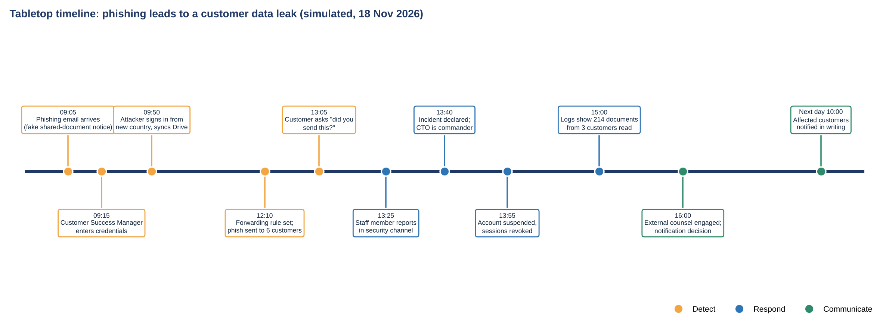

# Incident report: exercise INC-EX-2026-01

[← Project 4 README](README.md)

*This report documents a simulated tabletop exercise. No real incident or real customer data was involved.*

| Field | Entry |
|---|---|
| Incident ID | INC-EX-2026-01 |
| Title | Phishing leads to customer data leak (simulated) |
| Severity | 🟥 High |
| Detected | 18 Nov 2026 13:05 (customer query) |
| Declared | 18 Nov 2026 13:40 |
| Contained | 18 Nov 2026 14:10 |
| Closed | 18 Nov 2026 (exercise end) |
| Incident commander | CTO |
| Prepared by | GRC Analyst |

## 1. Summary

A staff member entered credentials on a fake Google sign-in page. The attacker captured the session, read 214 documents belonging to 3 customers, set a mail forwarding rule and sent phishing to 6 customers. A customer's question led to detection about four hours after the sign-in. The account was contained within 30 minutes of declaration, and the affected customers were told the next morning.

## 2. Timeline

| Time | Event | Who | Source |
|---|---|---|---|
| 09:05 | Phishing email arrives | Attacker | Mail log |
| 09:15 | Credentials entered; session captured | Customer Success Manager | Sign-in log |
| 09:50 | Sign-in from new country; Drive sync begins | Attacker | Google audit log |
| 12:10 | Forwarding rule created; phishing sent to 6 customers | Attacker | Mail log |
| 13:05 | A customer asks "did you send this?" | Customer | Support chat |
| 13:25 | Reported in the security channel | Customer Success Manager | Slack |
| 13:40 | Incident declared as High | CTO | Incident log |
| 13:55 | Account suspended, sessions revoked, password reset | Operations Manager | Admin console |
| 14:10 | Forwarding rule removed; sender domain blocked | Engineering Lead | Admin console |
| 15:00 | Log review: 214 documents from 3 customers accessed | GRC Analyst | Drive audit log |
| 16:00 | External counsel engaged; notification decision | CEO | Incident log |
| Next day 10:00 | Affected customers notified in writing | Customer Success Manager | Email |

## 3. Impact

| Area | Detail |
|---|---|
| Systems and accounts | One Google account; its Drive and mailbox |
| Data affected | 214 customer documents (from 3 customers) in a shared export folder; these may include personal data of the customers' own contacts |
| Customer or service effect | No outage; 6 customers received a phishing email from a trusted address |
| Legal or contractual duties | Customer contracts require notice within 72 hours. As a processor, NovaCloud tells customers without undue delay (GDPR Art. 33(2)) so they can assess their own duty to notify authorities |

## 4. Response steps taken

| Phase | Steps |
|---|---|
| Identify | Customer query escalated; staff member reported; commander classified High from sign-in logs |
| Respond | Account suspended; sessions and tokens revoked; password and MFA reset; forwarding rule removed; sender domain blocked; logs exported; files accessed counted |
| Communicate | CEO approved the notice; 3 affected customers notified in writing; the 6 recipients warned; staff briefed |

## 5. Notifications

| Who | Decision | Sent | By |
|---|---|---|---|
| 3 affected customers | Notify in writing | Next day 10:00 (about 20 hours after awareness) | Customer Success Manager |
| 6 phishing recipients | Warn not to open or reply | Same day 17:30 | Customer Success Manager |
| Data protection authorities | Customers decide as controllers; NovaCloud supplies facts on request | n/a | n/a |

## 6. Root cause and contributing factors

**Root cause:** the fake sign-in page captured the session, and the authenticator-app MFA used by NovaCloud is not phishing-resistant.

**Contributing factors:** no alert on a risky sign-in or a mass download; customer exports kept in shared Drive; no after-hours rota; no ready notification template; no phishing training yet.

## 7. Remediation actions

| Action ID | Action | Owner | Due | Status at 30 Nov 2026 |
|---|---|---|---|---|
| ACT-06 | Create an after-hours on-call rota and call tree | CTO | 05 Dec 2026 | In progress |
| ACT-07 | Write a customer notification template and name the decision owner | CEO | 20 Dec 2026 | In progress |
| ACT-08 | Move admins and then all staff to phishing-resistant MFA (security keys) | CTO | 28 Feb 2027 | In progress |
| ACT-09 | Alert on mass Drive downloads and extend log retention to 12 months | CTO | 31 Jan 2027 | Not started |
| ACT-10 | Move customer exports from shared Drive into a controlled bucket with expiry | Engineering Lead | 31 Dec 2026 | Not started |
| ACT-14 | Run onboarding training and the first phishing simulation | GRC Analyst | 31 Jan 2027 | Not started |

## 8. Lessons learned

- Detection relied on a customer noticing. Alerts and training must find problems first.
- The plan's containment steps worked, but communication and out-of-hours cover did not.
- Phishing-resistant MFA is the most effective single control against this attack.

## 9. Sign-off

| Role | Name | Date |
|---|---|---|
| Incident commander | CTO | 18 Nov 2026 |
| CEO | CEO | 18 Nov 2026 |

---

*NovaCloud AI Solutions is a fictional company. All people, systems, incidents, ratings and dates are examples created for skills practice and portfolio use. This is not legal advice or a compliance determination. Framework references are paraphrased pointers, so verify them against the source text before relying on them.*

Author: Augustine Ozor, AI Governance and Cybersecurity GRC. [GitHub](https://github.com/AugustineOzor) · [LinkedIn](https://www.linkedin.com/in/augustinetettehozor)
