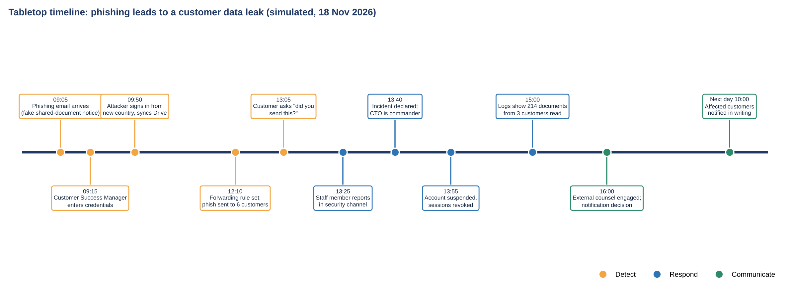

# Tabletop exercise: phishing leads to a customer data leak

[← Project 4 README](README.md)

| Item | Detail |
|---|---|
| Date | 18 Nov 2026 (simulated) |
| Duration | 90 minutes |
| Facilitator and scribe | GRC Analyst |
| Participants | CTO, Engineering Lead, CEO, Operations Manager, Customer Success Manager |
| Plan tested | [Incident response plan IRP-001](incident-response-plan.md) |

## Objectives

1. Test whether staff can detect, report and classify a phishing-led breach.
2. Test containment, evidence handling and decision-making.
3. Test the notification path to customers within the contract time.

## Scenario

On a Tuesday morning a fake "shared document" notice arrives from what looks like a known supplier. The Customer Success Manager opens it and signs in on a copy of the Google sign-in page. The attacker captures the sign-in session, so the MFA prompt does not stop them.

## Timeline of injects and what the team did

| Time | Inject | Expected action | What the team did | Gap? |
|---|---|---|---|---|
| 09:05 | Phishing email arrives | Filter or user reports it | Not reported; the email was opened | Training (ACT-14) |
| 09:15 | Manager enters credentials; MFA approved | MFA should block attacker | Attacker kept the session; MFA did not prevent it | Gap 3 |
| 09:50 | Sign-in from a new country; Drive sync starts | Alert on risky sign-in | Google sent an alert, but no one was watching it | Gap 4 |
| 12:10 | Forwarding rule set; phishing sent to 6 customers | Detect mail rule and outbound spam | Not detected | Gap 4 |
| 13:05 | A customer asks "did you send this?" | Escalate immediately | Customer Success relayed it by chat within 20 minutes | None |
| 13:25 | Staff member reports in the security channel | CTO classifies severity | CTO classified High within 15 minutes | None |
| 13:40 | Incident declared | Open incident channel, start timeline | Done; GRC Analyst kept the timeline | None |
| 13:55 | Containment | Suspend account, revoke sessions, remove rules | Done in 15 minutes; one forwarding rule was missed until the review | Minor |
| 15:00 | Review of logs | Find what was accessed | 214 documents from 3 customers were read; customer exports were in shared Drive | Gap 5 |
| 16:00 | Notification decision | Decide who must be told, and who decides | Debate over who could approve the customer notice; no template existed | Gap 2 |
| Next day | Customer notification | Within 72 hours | Drafted from scratch; sent at 10:00 the next day | Gap 2 |

## Identify, respond, communicate: steps documented

| Phase | Steps taken |
|---|---|
| **Identify** | Customer query reached Customer Success; staff member reported; CTO confirmed the account was compromised from sign-in logs; severity set to High |
| **Respond** | Suspended the account; revoked sessions and tokens; reset password; removed the forwarding rule; blocked the sending domain; saved Drive and sign-in logs; counted files accessed; engaged external counsel |
| **Communicate** | CEO approved the message; Customer Success told the 3 affected customers in writing the next day; the 6 recipients of the phishing email were warned; staff were briefed |

## What worked

- A customer's question was escalated within 20 minutes, and the CTO classified the incident quickly.
- Containment steps in the plan were clear and took 15 minutes.
- A scribe kept an accurate timeline, which made the report easy to write.

## Gaps found and actions

| Gap | Finding | Action | Owner | Due |
|---|---|---|---|---|
| 1 | No after-hours contact list; the group was reachable only because it was a weekday | ACT-06 Create an on-call rota and call tree | CTO | 5 Dec 2026 |
| 2 | No customer notification template; unclear who decides | ACT-07 Write a template and name the decision owner | CEO | 20 Dec 2026 |
| 3 | MFA by authenticator app or push can be bypassed by phishing | ACT-08 Move admins, then all staff, to security keys | CTO | 28 Feb 2027 |
| 4 | No alert on mass Drive downloads or forwarding rules; logs kept 90 days | ACT-09 Add alerts and extend retention to 12 months | CTO | 31 Jan 2027 |
| 5 | Customer exports sat in shared Drive, widening the impact | ACT-10 Move exports to a controlled bucket with expiry | Engineering Lead | 31 Dec 2026 |

These actions are on the shared action list used by the [dashboard](../06-compliance-dashboard/README.md) and the [internal audit](../07-mock-internal-audit/README.md).

---

*NovaCloud AI Solutions is a fictional company. All people, systems, incidents, ratings and dates are examples created for skills practice and portfolio use. This is not legal advice or a compliance determination. Framework references are paraphrased pointers, so verify them against the source text before relying on them.*

Author: Augustine Ozor, AI Governance and Cybersecurity GRC. [GitHub](https://github.com/AugustineOzor) · [LinkedIn](https://www.linkedin.com/in/augustinetettehozor)
