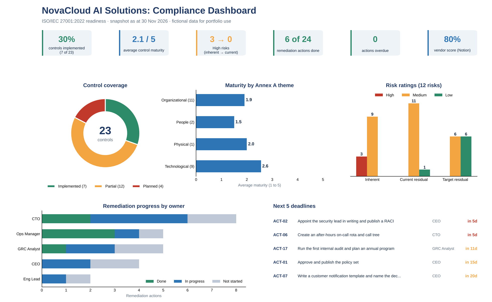

# Compliance dashboard

[← Project 6 README](README.md)

**Snapshot date:** 30 Nov 2026 · **Data:** [Project 1 control matrix](../01-mini-compliance-program/03-iso-27001-control-matrix.md), [Project 2 risk register](../02-risk-register/risk-register.md) and the action list below.

*The same dashboard is built in Excel, with live formulas and charts: [NovaCloud_Compliance_Dashboard.xlsx](NovaCloud_Compliance_Dashboard.xlsx).*

## What the dashboard says

| Measure | Value | Reading |
|---|---|---|
| Controls implemented | 7 of 23 (30%) | A small base: most controls are partial or planned |
| Average maturity | 2.1 of 5 | Technology is ahead of policy and people controls |
| High risks, inherent to current | 3 to 0 | Existing controls bring every High risk down to Medium |
| Risks at target | 6 Low, 6 Medium | Target shows the benefit of finishing the actions |
| Remediation actions | 6 done, 10 in progress, 8 not started | Progress is real but 8 actions have not started |
| Overdue actions | 0 on 30 Nov 2026 | Two fall due on 5 December 2026 (see the next deadlines) |

## Metric definitions

| Metric | Definition | Source |
|---|---|---|
| Control coverage | Count of controls by status (Implemented, Partial, Planned) | Controls sheet |
| Maturity | Average of the 1 to 5 maturity score, by Annex A theme | Controls sheet |
| Risk ratings | Count of risks by Low, Medium, High at inherent, current and target | Risks sheet |
| Remediation progress | Count of actions by status, and by owner | Actions sheet |
| Overdue | Due date before the snapshot date and status not Done | Actions sheet |
| Next deadlines | The five earliest due dates among open actions | Actions sheet |

## Action list (shared across the portfolio)

| ID | Action | Control | Owner | Due | Status |
|---|---|---|---|---|---|
| ACT-01 | Approve and publish the policy set | A.5.1 | CEO | 15 Dec 2026 | 🟦 In progress |
| ACT-02 | Appoint the security lead in writing and publish a RACI | A.5.2 | CEO | 05 Dec 2026 | ⬜ Not started |
| ACT-03 | Write the acceptable use policy and collect acknowledgments | A.5.10 | GRC Analyst | 15 Jan 2027 | ⬜ Not started |
| ACT-04 | Assess the remaining 11 vendors, Critical tier first | A.5.19 | Operations Manager | 31 Mar 2027 | 🟦 In progress |
| ACT-05 | Document shared responsibility and enable AWS Config conformance pack | A.5.23 | CTO | 31 Jan 2027 | 🟦 In progress |
| ACT-06 | Create an after-hours on-call rota and call tree | A.5.24 | CTO | 05 Dec 2026 | 🟦 In progress |
| ACT-07 | Write a customer notification template and name the decision owner | A.5.24 | CEO | 20 Dec 2026 | 🟦 In progress |
| ACT-08 | Move admins and then all staff to phishing-resistant MFA (security keys) | A.8.5 | CTO | 28 Feb 2027 | 🟦 In progress |
| ACT-09 | Alert on mass Drive downloads and extend log retention to 12 months | A.8.15 | CTO | 31 Jan 2027 | ⬜ Not started |
| ACT-10 | Move customer exports from shared Drive into a controlled bucket with expiry | A.5.15 | Engineering Lead | 31 Dec 2026 | ⬜ Not started |
| ACT-11 | Define RTO and RPO and run a database restore test | A.8.13 | CTO | 31 Jan 2027 | ⬜ Not started |
| ACT-12 | Remove standing admin access and use time-limited SSO roles | A.8.2 | CTO | 15 Jan 2027 | 🟦 In progress |
| ACT-13 | Run weekly infrastructure scans and set fix times | A.8.8 | Engineering Lead | 31 Jan 2027 | 🟦 In progress |
| ACT-14 | Run onboarding training and the first phishing simulation | A.6.3 | GRC Analyst | 31 Jan 2027 | ⬜ Not started |
| ACT-15 | Publish a remote working guide | A.6.7 | Operations Manager | 15 Jan 2027 | ⬜ Not started |
| ACT-16 | Create a record of processing and a DPA template | A.5.34 | CEO | 28 Feb 2027 | ⬜ Not started |
| ACT-17 | Run the first internal audit and plan an annual program | A.5.36 | GRC Analyst | 11 Dec 2026 | 🟦 In progress |
| ACT-18 | Capture the SOC 2 evidence screenshots listed in the evidence guide | A.8.5, A.8.24, A.5.15 | GRC Analyst | 31 Dec 2026 | 🟦 In progress |
| ACT-19 | Create the asset inventory | A.5.9 | Operations Manager | 06 Nov 2026 | 🟩 Done |
| ACT-20 | Enforce MFA on Google, AWS and GitHub | A.8.5 | CTO | 13 Nov 2026 | 🟩 Done |
| ACT-21 | Enroll all laptops in MDM with disk encryption and EDR | A.8.1, A.8.7 | Operations Manager | 13 Nov 2026 | 🟩 Done |
| ACT-22 | Build the vendor template and assess the first vendor | A.5.19 | Operations Manager | 20 Nov 2026 | 🟩 Done |
| ACT-23 | Write the incident response plan and run a tabletop | A.5.24 | CTO | 20 Nov 2026 | 🟩 Done |
| ACT-24 | Build the risk register with heat map | Clause 6.1.2 | GRC Analyst | 13 Nov 2026 | 🟩 Done |

## Next five deadlines

| ID | Action | Owner | Due | Days left |
|---|---|---|---|---|
| ACT-02 | Appoint the security lead in writing and publish a RACI | CEO | 05 Dec 2026 | 5 |
| ACT-06 | Create an after-hours on-call rota and call tree | CTO | 05 Dec 2026 | 5 |
| ACT-17 | Run the first internal audit and plan an annual program | GRC Analyst | 11 Dec 2026 | 11 |
| ACT-01 | Approve and publish the policy set | CEO | 15 Dec 2026 | 15 |
| ACT-07 | Write a customer notification template and name the decision owner | CEO | 20 Dec 2026 | 20 |

## How to update it

1. Open the Excel workbook and change the **snapshot date** on the Dashboard sheet.
2. Update statuses and maturity on the **Controls** sheet, scores on the **Risks** sheet, and statuses and due dates on the **Actions** sheet (blue cells).
3. Everything else (counts, ratings, overdue flags, charts) recalculates.

## Building the same dashboard in Notion

1. Create three databases: **Controls** (Control ID, Name, Theme, Status, Maturity, Owner, Action), **Risks** (ID, Likelihood, Impact, Score as a formula, Rating, Owner) and **Actions** (ID, Action, Owner, Due, Status, Control as a relation).
2. Add a **Dashboard page** with linked views: a board grouped by Status, a table of overdue actions (filter: Due before today, Status is not Done), and charts for Status and Rating.
3. Add a rollup on Controls to count open actions per control.

---

*NovaCloud AI Solutions is a fictional company. All people, systems, incidents, ratings and dates are examples created for skills practice and portfolio use. This is not legal advice or a compliance determination. Framework references are paraphrased pointers, so verify them against the source text before relying on them.*

Author: Augustine Ozor, AI Governance and Cybersecurity GRC. [GitHub](https://github.com/AugustineOzor) · [LinkedIn](https://www.linkedin.com/in/augustinetettehozor)
